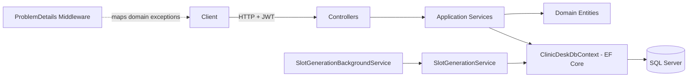

# ClinicDesk API

> Clinic appointment scheduling REST API: versioned doctor schedules, race-safe booking with optimistic concurrency, and a FIFO waitlist with automatic promotion.

[](https://github.com/edu-tech220/clinicdesk-api/actions/workflows/ci.yml)


Built with C# / .NET 8, ASP.NET Core Web API, Entity Framework Core and SQL Server (SQLite in tests).

---

## 📋 Overview

A clinic needs patients to book appointments with a doctor without stepping on each other, doctors to define and change their weekly hours without losing history, and freed-up slots (after a cancellation) to go automatically to whoever was already waiting — instead of being grabbed first-come, first-served by anyone. That requires domain rules well beyond a plain CRUD.

## ✨ Key features & business rules

- **Race-safe booking** — if two patients try to take the same slot at almost the same time, only one wins; the other gets a `409 Conflict` and can retry or join the waitlist.
- **Versioned schedules** — when a doctor changes their weekly schedule, previous rules are never deleted or overwritten: they are closed (`EffectiveTo`) and new rules are inserted. Already generated slots keep a reference to the schedule version they were created from.
- **FIFO waitlist with automatic promotion** — when a patient cancels a confirmed appointment and someone is waiting for that slot, the first person in line is promoted automatically in the same transaction, instead of the slot simply being released.
- **Cancellation policy** — cancelling more than 24 hours in advance (configurable) is recorded as `Cancelled`; cancelling later is recorded as `LateCancelled`, so effective patient no-shows can be measured.
- **Appointment lifecycle** — `Confirmed → Completed | Cancelled | LateCancelled | NoShow`. Past slots cannot be booked, an appointment cannot be completed before it starts, and a no-show cannot be recorded before the appointment time.
- **Background slot generation** — a `BackgroundService` runs every 6 hours and generates each doctor's available slots from their active schedule (14 days ahead by default), idempotently: existing slots are never duplicated. Doctors/admins can also trigger generation manually.
- **JWT auth with roles** — `Patient`, `Doctor` and `Admin`, with ownership checks (a doctor can only manage their own schedule and appointments).
- **Rate limiting** — fixed-window limits on authentication and booking endpoints.

## 🏗️ Architecture

A single API project (`ClinicDesk.Api`) organized in layers by folder — not split into multiple class libraries, because the scope doesn't justify it.



- Controllers never talk to EF Core directly: they call the services in `Application.Services`, which are the only classes that use `ClinicDeskDbContext`.
- Domain exceptions (`NotFoundException`, `ConflictException`, `ValidationException`, `ForbiddenException`, `UnauthorizedDomainException`) are translated into `ProblemDetails` by a central middleware (`ProblemDetailsExceptionMiddleware`), so services know nothing about HTTP status codes and controllers have no repeated try/catch blocks.

### Domain model

`Specialty` 1—N `Doctor` 1—N `DoctorSchedule` (versioned) → `SlotGenerationService` generates `AppointmentSlot`s → a `Patient` books an `AppointmentSlot`, creating an `Appointment`. If the slot is taken, the patient can create a `WaitlistEntry` (FIFO), which is promoted automatically when the current appointment is cancelled.

## 🧠 Technical decisions

- **Application-managed concurrency token instead of `rowversion`** — `AppointmentSlot` and `Appointment` implement `IConcurrencyAware` with a `Version` (`Guid`) property configured with `IsConcurrencyToken()`. `ClinicDeskDbContext` regenerates it on every `SaveChanges` for modified entities. This was chosen over SQL Server's native `[Timestamp]`/`rowversion` because that type has no real equivalent in SQLite, and the tests had to run on SQLite without changing the concurrency behavior used in production on SQL Server. The conflict detection mechanism (comparing the original value against the database value on `UPDATE`) is the same on both engines. A `DbUpdateConcurrencyException` becomes a `409 Conflict`.
- **Schedule rules are versioned, never edited in place** — `DoctorService.SetScheduleAsync` never runs an `UPDATE` on an existing `DoctorSchedule` row; it closes the current one (`EffectiveTo`) and creates a new one. `AppointmentSlot.DoctorScheduleId` keeps pointing to the version it was generated from, which is useful for auditing.
- **Slot generation without N+1 queries** — `SlotGenerationService` loads all existing `StartsAtUtc` values for a doctor's date range in a single query and checks membership in memory (`HashSet`) instead of querying the database slot by slot before inserting. A unique index on `(DoctorId, StartsAtUtc)` backs this up at the database level.
- **Waitlist promotion inside the cancellation transaction** — `AppointmentService.CancelAsync` decides, within the same `SaveChanges`, whether to release the slot or promote the first waiting patient, leaving no window where the slot appears available to third parties.
- **JWT with domain claims** — besides `sub`, `email` and `role`, the token includes `pid` (PatientId) or `did` (DoctorId) depending on the role, avoiding an extra query on every request to resolve that id. `MapInboundClaims = false` stops ASP.NET Core from remapping short claim names to long URIs.
- **Hand-rolled PBKDF2 instead of ASP.NET Core Identity** — the requirement is simple (hash + verify), and using `Rfc2898DeriveBytes.Pbkdf2` directly avoids pulling in Identity's user model for a use case that doesn't need it.
- **Fixed-window rate limiting** — the `auth` and `booking` policies (`AddFixedWindowLimiter`, 10 requests/minute, no queue) mitigate brute force on login and spam of booking attempts; rejected requests receive `429 Too Many Requests`.

## 🧰 Tech stack

| Area | Technology |
|---|---|
| Runtime | .NET 8, C# |
| Web | ASP.NET Core Web API (controllers), Swashbuckle / Swagger |
| Data | Entity Framework Core 8, SQL Server 2022 (SQLite in-memory for tests) |
| Auth | JWT Bearer, PBKDF2 password hashing |
| Resilience | ASP.NET Core rate limiting, optimistic concurrency |
| Background jobs | `BackgroundService` (hosted service) |
| Testing | xUnit, `WebApplicationFactory`, SQLite in-memory |
| DevOps | Docker, Docker Compose, GitHub Actions |

## 🚀 Getting started

### With Docker Compose (API + SQL Server)

```bash
docker compose up --build
```

The API is available at `http://localhost:8080`. Swagger is served at `/swagger` only when `ASPNETCORE_ENVIRONMENT=Development` (the compose file runs the API in `Production`).

> The credentials and `Jwt:SigningKey` in `docker-compose.yml` and `appsettings.json` are sample values for local development, **not real secrets** — change them before deploying anywhere real.

### Locally, without Docker

You need a reachable SQL Server instance (it can be the one from `docker compose up sqlserver`) and a connection string in `src/ClinicDesk.Api/appsettings.json` / `appsettings.Development.json` or in the `ConnectionStrings__ClinicDesk` environment variable.

```bash
dotnet run --project src/ClinicDesk.Api
```

With the default `http` launch profile the API listens on `http://localhost:5108` (Swagger at `http://localhost:5108/swagger`). When running outside the `Testing` environment, `Program.cs` applies pending migrations on startup (`db.Database.Migrate()`), so there is no need to run `dotnet ef database update` manually.

### Configuration

| Section | Key | Purpose |
|---|---|---|
| `ConnectionStrings` | `ClinicDesk` | SQL Server connection string (not used in `Testing`) |
| `Jwt` | `Issuer`, `Audience`, `SigningKey`, `ExpirationMinutes` | Token signing and validation |
| `ClinicPolicy` | `FreeCancellationWindowHours` | Hours in advance to cancel without penalty (default `24`) |
| `ClinicPolicy` | `SlotGenerationHorizonDays` | Days ahead generated by the `BackgroundService` (default `14`) |

## 🧪 Running tests

```bash
dotnet test
```

**39 tests** (xUnit). They need neither SQL Server nor Docker — they use in-memory SQLite.

- **Service tests** (`tests/ClinicDesk.Api.Tests/Services`) use `SqliteInMemoryFixture`, which opens a shared `:memory:` SQLite connection across several independent `ClinicDeskDbContext` instances. This makes it possible to simulate two concurrent "requests" reading the same slot before either saves changes — so the concurrency token is really tested, not just the business shortcut based on `Status`.
- **Integration tests** (`tests/ClinicDesk.Api.Tests/Integration`) spin up the whole API with `WebApplicationFactory<Program>` in the `Testing` environment, where `Program.cs` skips SQL Server registration, automatic migration and the slot generation `BackgroundService`, and use their own in-memory SQLite database.

Coverage includes: optimistic concurrency on booking, free vs. late cancellation policy, FIFO waitlist promotion, schedule versioning without losing history, idempotent slot generation, appointment lifecycle, pagination, password hashing, JWT generation, role-based authorization, rate limiting and the error format (`ProblemDetails`).

## 🔌 API endpoints

| Method | Route | Role | Description |
|---|---|---|---|
| POST | `/api/auth/register` | Public | Registers a patient and returns a JWT |
| POST | `/api/auth/login` | Public | Logs in and returns a JWT |
| POST | `/api/auth/doctors` | Admin | Creates a doctor account |
| GET | `/api/specialties` | Public | Lists specialties |
| POST | `/api/specialties` | Admin | Creates a specialty |
| GET | `/api/doctors` | Public | Lists doctors (filter by specialty, paginated) |
| GET | `/api/doctors/{doctorId}` | Public | Gets a doctor |
| GET | `/api/doctors/{doctorId}/schedule` | Public | Gets the doctor's weekly schedule |
| PUT | `/api/doctors/{doctorId}/schedule` | Owning doctor / Admin | Replaces the weekly schedule (versioned) |
| POST | `/api/doctors/{doctorId}/generate-slots` | Owning doctor / Admin | Triggers slot generation manually |
| GET | `/api/doctors/{doctorId}/slots` | Authenticated | Doctor's agenda (paginated, filterable by status and date range) |
| POST | `/api/appointments` | Patient | Books an available slot |
| POST | `/api/slots/{slotId}/waitlist` | Patient | Joins the waitlist for a booked slot |
| GET | `/api/appointments` | Authenticated | Lists appointments (scoped by role: own, or all for Admin) |
| GET | `/api/appointments/{appointmentId}` | Authenticated | Gets an appointment |
| PATCH | `/api/appointments/{appointmentId}/cancel` | Owner / Doctor / Admin | Cancels a confirmed appointment |
| PATCH | `/api/appointments/{appointmentId}/complete` | Owning doctor / Admin | Marks an appointment as completed |
| PATCH | `/api/appointments/{appointmentId}/no-show` | Owning doctor / Admin | Marks a no-show |

Errors are returned as `ProblemDetails` (`400`, `401`, `403`, `404`, `409`, `429`).

## 📁 Project structure

```
ClinicDesk.sln
├── src/ClinicDesk.Api/
│   ├── Domain/              # Entities and enums, no EF Core / ASP.NET dependencies
│   ├── Application/         # Use cases (Services), DTOs, abstractions, domain exceptions
│   ├── Infrastructure/      # DbContext, migrations, password hashing, JWT
│   ├── BackgroundServices/  # Periodic slot generator
│   ├── Common/              # ProblemDetails middleware, options, claims, extensions
│   ├── Controllers/         # HTTP endpoints: map DTOs <-> services, enforce authorization
│   └── Program.cs
├── tests/ClinicDesk.Api.Tests/
│   ├── Infrastructure/      # WebApplicationFactory, SQLite fixture, test data builder
│   ├── Integration/         # Auth, authorization and rate limiting over HTTP
│   └── Services/            # Concurrency, cancellation, lifecycle, scheduling, slots
├── .github/workflows/ci.yml # Restore, build, test and Docker image build
├── Dockerfile
├── docker-compose.yml
└── global.json
```
